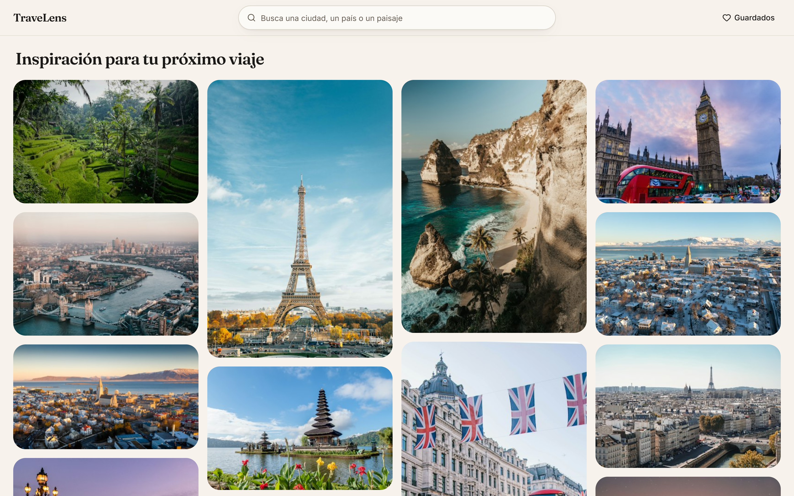
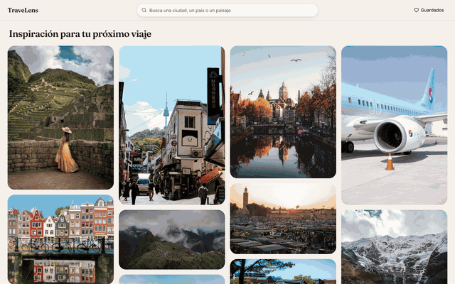

# TraveLens

A Pinterest-style travel explorer with AI-generated trip plans. Browse destinations as a masonry grid of Unsplash photos, open one, and Gemini writes a 3-day plan for the place in the picture. Save the places you like and come back to them later. The interface is in Spanish.



Built with Next.js 16 (App Router, Cache Components, Partial Prerendering), React 19, Tailwind CSS v4, shadcn/ui, the Unsplash API and the Gemini API (`@google/genai`).

## Contents

- [App showcase](#app-showcase)
- [Getting started](#getting-started)
- [Project architecture](#project-architecture)
- [How the API connections work](#how-the-api-connections-work)
- [Testing](#testing)
- [Role contribution log](#role-contribution-log)
- [Known limitations](#known-limitations)

## App showcase



▶ **Full-quality video:** [assets/travelens-demo.mp4](assets/travelens-demo.mp4) (H.264, 1440×900, 30 fps, 34 s). The GIF above is the same recording, downscaled, because GitHub doesn't play videos stored in the repository inline.

**What the demo shows, in order:**

1. **Home feed:** "Inspiración para tu próximo viaje", a masonry grid of curated cities.
2. **Search:** typing "Santorini" in *Busca una ciudad, un país o un paisaje*. The results fade in tile by tile.
3. **Save (Guardar):** hovering two tiles reveals their title and the heart button. Each save plays a heart pop, and the header's *Guardados* count goes up.
4. **Keyboard navigation:** the arrow keys move focus between tiles by their position on screen.
5. **Recent searches:** a second search ("Kioto") adds *Búsquedas recientes* chips under the search bar. Clicking the *Santorini* chip goes back to those results.
6. **Destination page:** opening a photo of Oia shows the "La IA está creando tu plan perfecto" banner while Gemini writes the plan (live call, about 2.5 s). Then the 3-day plan appears and the panel scrolls through it, next to *Destinos Similares*.
7. **Saved places:** the header's *Guardados* link opens `/saved` with the saved photos.

### Pages

| Route | What it shows |
|---|---|
| `/` | A feed of 30 curated cities in a random order per visit, or search results for `?q=…`. Infinite scroll. |
| `/destination/[id]` | The photo with its tags and credit, the AI travel plan, and a mosaic of 8 similar destinations. |
| `/saved` | The places saved with the heart button, newest first. Stored in the browser, no account needed. |

### UI/UX features: technical summary

| Area | Implementation |
|---|---|
| **Masonry grid** | CSS columns (2 → 5 by breakpoint). Each tile reserves its aspect ratio from the photo's `width`/`height` and shows Unsplash's dominant `color` until the image loads, so nothing jumps. The first page loads eagerly because CSS columns spread the top-of-screen tiles across the whole list. ([`masonry-grid.tsx`](src/components/features/masonry-grid.tsx)) |
| **Staggered fade-in** | tw-animate-css `animate-in fade-in slide-in-from-bottom-2`, with `animation-delay` = 40 ms per tile, capped at 600 ms. Delays count from the first tile of each newly loaded page (`staggerFrom`), so later pages don't wait the full cap. |
| **Infinite scroll** | An `IntersectionObserver` on a sentinel 800 px below the grid loads the next page from `/api/photos`. The home feed passes back its `seed`, so page 2 continues the same random city order. ([`photo-feed.tsx`](src/components/features/photo-feed.tsx)) |
| **Search** | The URL (`?q=`) is the single source of truth, so results can be shared, bookmarked and restored with Back. Input is debounced (350 ms) and written with `router.replace` inside a transition, keeping the old grid visible while the server renders the new one. Escape clears. ([`search-bar.tsx`](src/components/features/search-bar.tsx)) |
| **Recent searches** | The last 6 queries, deduplicated case-insensitively. A search is recorded on Enter or when the field loses focus, never per keystroke, so partial words aren't saved. Each chip links to `/?q=…` and can be removed; *Borrar* clears them all. ([`recent-searches.tsx`](src/components/features/recent-searches.tsx)) |
| **Favorites** | `SaveButton` toggles a snapshot of the photo in localStorage (`aria-pressed`, labels *Guardar* / *Quitar de guardados*). It sits beside the tile's link, not inside it, because a button inside a link is invalid HTML. Saving also reports a download to Unsplash, as its guidelines require. ([`save-button.tsx`](src/components/features/save-button.tsx), [`favorites.ts`](src/lib/favorites.ts)) |
| **Heart pop** | `heart-pop` (scale 1 → 1.35 → 0.9 → 1) and a `heart-ring` burst, 450 ms, defined in [`globals.css`](src/app/globals.css). They play only on unsaved → saved: a click counter is the animated element's `key`, so each save remounts it and replays the animation. |
| **Saved page** | A static, prerendered shell. The grid renders from localStorage after hydration; until then it shows a skeleton, so the empty state never flashes. The header link shows the saved count. ([`saved-photos.tsx`](src/components/features/saved-photos.tsx)) |
| **Keyboard navigation** | CSS columns order the DOM column by column, so "next index" is the wrong tile. `findNextTile()` picks the target from the tiles' on-screen rectangles: up/down stay in the column, left/right take the nearest column and the closest vertical centre. One delegated `onKeyDown` serves every tile, including ones added by infinite scroll. Tab order is unchanged. ([`grid-navigation.ts`](src/lib/grid-navigation.ts)) |
| **AI plan loading** | While Gemini works, a banner says "La IA está creando tu plan perfecto". Status messages advance every 1.8 s, starting with the destination's name, and a progress bar fills with them (shimmer overlay, twinkling sparkles icon). The messages are paced by time: the API returns the whole plan at once. ([`travel-plan-panel.tsx`](src/components/features/travel-plan-panel.tsx)) |
| **Destination layout** | Three columns that fill exactly the viewport below the header on desktop; the plan column scrolls on its own. The photo renders on the server, the similar-photos mosaic streams in behind its own skeleton, and the plan is fetched by the browser with error and *Reintentar* states. |
| **Theme** | "Warm editorial": ivory, ink and terracotta oklch tokens, pine as a secondary hue, Fraunces for headings and Inter for text. Measured contrast: 15.8:1 for body text, 4.7:1 for the primary button. |
| **Accessibility** | Every animation is `motion-safe:` only. Loading states are announced once through a `role="status"` line; the plan's changing messages are `aria-hidden` so screen readers aren't interrupted every 1.8 s. Visible focus rings throughout, and keyboard focus reveals tile titles. |

The screenshot and video were captured with Playwright driving Chrome at a 1440×900 viewport against the development server: the screenshot at 2× device pixel ratio, the video at 2× through the DevTools screencast, encoded to 1440×900. The photos and the AI plan are live API data.

## Getting started

**Requirements:** Node.js 20.9 or later (developed on Node 24) and npm.

1. **Install dependencies:**

   ```bash
   npm install
   ```

2. **Add your API keys.** Copy `.env.example` to `.env.local` and fill in both values:

   ```bash
   cp .env.example .env.local
   ```

   | Variable | Where to get it | Used by | Without it (development only) |
   |---|---|---|---|
   | `UNSPLASH_ACCESS_KEY` | [unsplash.com/oauth/applications](https://unsplash.com/oauth/applications): create an app, copy its **Access Key** | `src/services/unsplash.ts` (photos, search, similar destinations) | Demo mode: 30 bundled sample photos |
   | `GEMINI_API_KEY` | [aistudio.google.com/apikey](https://aistudio.google.com/apikey) | `src/services/gemini.ts` (travel plans) | Demo mode: a fixed sample plan, labelled as not AI-generated |

   - `.env.local` is git-ignored.
   - **Never prefix these names with `NEXT_PUBLIC_`.** That would ship the keys to every visitor's browser. They are read only on the server.
   - A new Unsplash app is limited to 50 requests per hour. Responses are cached, so normal browsing stays well under it.

3. **Start the development server** and open <http://localhost:3000>:

   ```bash
   npm run dev
   ```

**Demo mode:** if a key is missing in development, that service switches to bundled sample data and the header shows a *Modo demo* badge. Production builds always require both keys.

| Script | What it does |
|---|---|
| `npm run dev` | Development server on port 3000. Opening it from another device on your network (e.g. `http://192.168.1.23:3000`) works because `next.config.ts` allows `192.168.1.*`. |
| `npm run build` / `npm start` | Production build and server (both API keys required). |
| `npm run lint` | ESLint. |
| `npm test` | Unit and component tests (Vitest + Testing Library, jsdom). |

## Project architecture

TraveLens is one Next.js app. Pages are React Server Components; the interactive parts (search, infinite scroll, favorites, the AI plan) are client components. The two external APIs are reached only from the server, through a small service layer.

```
Browser (client components)          Server Components (pages)
   │  fetch('/api/...')                 │  call services directly
   ▼                                    │
src/app/api/**/route.ts   (BFF)         │  validate input (zod) → call service → map errors
   │                                    │
   ▼                                    ▼
src/services/*.ts   ('server-only', 'use cache')   ← the only code that reads API keys
   │
   ▼
Unsplash API · Gemini API

Browser-only state: localStorage (saved places, recent searches)
```

### Folder structure

```
src/
├── app/
│   ├── page.tsx                      Home: curated feed or search results
│   ├── destination/[id]/             Photo · AI plan · similar destinations (+ error and not-found pages)
│   ├── saved/page.tsx                Saved places
│   ├── api/photos/route.ts           GET: search, or the curated feed page by page
│   ├── api/photos/[id]/download/     POST: Unsplash download tracking
│   ├── api/ai-plan/route.ts          POST: Gemini travel plan
│   ├── layout.tsx                    Fonts, metadata, providers
│   └── globals.css                   Theme tokens and custom animations
├── components/
│   ├── features/                     Product components: SearchBar, PhotoFeed, MasonryGrid, PhotoCard,
│   │                                 SaveButton, TravelPlanPanel, SimilarMosaic, RecentSearches…
│   └── ui/                           shadcn/ui primitives (generated, not hand-edited)
├── services/
│   ├── unsplash.ts                   Unsplash client: feed, search, related photos, photo detail
│   ├── gemini.ts                     Gemini client: travel plan generation
│   └── fixtures/demo-photos.ts       Sample data for demo mode
├── lib/
│   ├── env.ts · errors.ts            Server env access, error → HTTP mapping
│   ├── photo-text.ts                 Cleaning Unsplash text (IDs, file names, promo clauses)
│   ├── local-store.ts                SSR-safe localStorage store (useSyncExternalStore)
│   ├── favorites.ts · recent-searches.ts
│   └── grid-navigation.ts            Geometric arrow-key navigation
├── types/travel.ts                   Shared contracts: Photo, PhotoSearchResult, TravelPlan
└── test/make-photo.ts                Test fixture
```

### How each page is rendered

| Route | Rendering | Why |
|---|---|---|
| `/` | Partial Prerendering | The header, search box and grid skeleton are prerendered at build time and sent instantly. The results for `?q=` stream in behind a `<Suspense>` boundary. |
| `/destination/[id]` | Partial Prerendering | The shell is static. The photo is awaited on the server, the similar-photos mosaic streams separately, and the plan is fetched by the browser so the page is interactive before the slowest call finishes. |
| `/saved` | Static | The list lives in the browser's localStorage, so the server has nothing to render but the shell. |
| `/api/*` | Dynamic | Request-time route handlers. |

### Key design decisions

- **Backend-for-frontend routes.** The browser only calls TraveLens's own `/api/*` routes. Each validates input with zod, calls a service and maps failures to a safe JSON error: 400 invalid input, 429 rate limit, 502 upstream failure, 504 timeout, 500 unknown.
- **Caching inside services.** Searches are cached for 1 hour, photo details and AI plans for 1 day, using `'use cache'` with `cacheLife`. Repeat visits cost no API quota.
- **Unsplash images are hotlinked** from `images.unsplash.com` (`unoptimized` on `next/image`), as Unsplash's API terms require.
- **Code tour:** comments marked `REVIEWER_NOTE` in the source explain the non-obvious parts. [ARCHITECTURE.md](ARCHITECTURE.md) has the full reference: BFF rules, theme tokens, Unsplash field mapping and handoff notes.

## How the API connections work

This section explains [`src/services/unsplash.ts`](src/services/unsplash.ts) and [`src/services/gemini.ts`](src/services/gemini.ts): how each connection is set up, how requests are built and responses read, and how the photos and the AI plan stay about the same place.

### 1. Establishing the connections

Both APIs are called **only from the server**. The browser never talks to Unsplash's API or to Gemini directly, and never sees a key.

```
Browser                         TraveLens server (Next.js)                     External APIs
───────                         ──────────────────────────                     ─────────────
page request ─────────────────▶ Server Components ──┐
                                                    ├─▶ services/unsplash.ts ──▶ api.unsplash.com
fetch('/api/photos') ─────────▶ app/api/photos ─────┤
fetch('/api/ai-plan') ────────▶ app/api/ai-plan ────┴─▶ services/gemini.ts ────▶ generativelanguage.googleapis.com
```

Three things enforce this:

- **Keys are read on the server only.** `getServerEnv()` in [`src/lib/env.ts`](src/lib/env.ts) reads `process.env.UNSPLASH_ACCESS_KEY` / `GEMINI_API_KEY` and throws if one is missing. Next.js only exposes variables prefixed `NEXT_PUBLIC_` to the browser, and these aren't.
- **The services can't end up in browser code.** Both files start with `import "server-only"`, so the build fails if a client component ever imports them.
- **The browser goes through "backend for frontend" (BFF) routes.** When the browser needs data after the page has loaded (more photos while scrolling, the AI plan), it calls TraveLens's own routes in `src/app/api/`. Each route validates its input with zod, calls a service, and turns failures into a safe JSON error.

The two connections are set up differently:

| | Unsplash | Gemini |
|---|---|---|
| Client | Plain `fetch` (no SDK), in `unsplashFetch()` | Official SDK: `new GoogleGenAI({ apiKey })` from `@google/genai` |
| Endpoint | `https://api.unsplash.com` + path | `POST https://generativelanguage.googleapis.com/{api_version}/interactions` (built by the SDK) |
| Authentication | Header `Authorization: Client-ID <UNSPLASH_ACCESS_KEY>` | Header `x-goog-api-key: <GEMINI_API_KEY>` (added by the SDK) |
| Other headers | `Accept-Version: v1` pins the API version | Set by the SDK |
| Timeout | 10 s (`AbortSignal.timeout`) | 20 s (`timeout_ms` request option) |
| Without a key | Demo fixture in `src/services/fixtures/demo-photos.ts` | Fixed sample plan (`demoPlan()`) |

`isDemoMode(key)` decides the last row: it's true only when the key is missing **and** the app isn't a production build.

### 2. Building requests and reading responses

#### Unsplash

**One function makes every call.** `unsplashFetch(path, params)` builds the URL with `new URL(path, "https://api.unsplash.com")`, appends the query parameters, sends the request with the auth headers and a timeout, then:

| Response | Result |
|---|---|
| `200` | Parsed JSON, typed as the expected shape |
| `404` | `null` (the destination page shows "Este destino no existe") |
| Error with header `X-Ratelimit-Remaining: 0`, or `429` | `UpstreamError` with status 429. Unsplash signals an exhausted rate limit with `403`, so the header is the reliable signal. |
| Other error, or a timeout | `UpstreamError` (502 / 504) |

**Three endpoints are used:**

| Endpoint | Parameters | Called by | Purpose |
|---|---|---|---|
| `GET /search/photos` | `query`, `page`, `per_page`, `content_filter=high` | `rawSearch()` → `fetchPopular()`, `searchDestinations()`, `fetchRelated()` | Every list of photos |
| `GET /photos/:id` | none | `rawPhoto()` → `getPhoto()` | The destination page's photo, with location and tags |
| `GET /photos/:id/download` | none | `trackDownload()`, via `POST /api/photos/[id]/download` when a photo is saved | Download counting required by Unsplash's guidelines |

**What each public function sends:**

- `fetchPopular({ seed, page })` builds the home feed. It shuffles 30 curated cities using `seed`, takes 4 per page, and searches each as `"<City> travel"` (e.g. `query=Lisbon+travel&per_page=6`). The four result lists are interleaved, so neighbouring tiles show different cities.
- `searchDestinations(query, page)` sends the search box text as `query`, 24 photos per page.
- `fetchRelated(location, tags, excludedId, fallbackCity)` fills "Destinos Similares". Section 3 covers it.

**Both responses are cached.** `rawSearch()` and `rawPhoto()` are marked `"use cache"`, so Next.js stores their results keyed by their arguments: one hour for searches, one day for photo details. Repeat requests cost no Unsplash quota (demo keys allow 50 requests per hour).

**Reading the JSON.** Unsplash returns more fields than the app needs. `toRecord()` maps the raw photo object to TraveLens's own `Photo` type using these paths:

| JSON path | Becomes | Notes |
|---|---|---|
| `total_pages` | `totalPages` | Search only; tells infinite scroll when to stop |
| `results[]` | One `Photo` each | Search only; `/photos/:id` returns a single object |
| `id` | `id` | Used in `/destination/[id]` links |
| `width`, `height` | `width`, `height` | Each tile reserves its aspect ratio before the image loads |
| `color` | `color` | Placeholder background while loading |
| `urls.thumb` | `urls.thumb` | Similar-destinations mosaic (200 px) |
| `urls.small` | `urls.small` | Home and search grid (400 px) |
| `urls.regular` | `urls.regular` | Destination page photo (1080 px) |
| `description` | `description`, 1st choice | Written by the photographer; `cleanDescription()` drops links, @handles, #hashtags and clauses like "follow me on instagram" or camera details |
| `alternative_slugs.es` | `description`, 2nd choice | Unsplash's Spanish summary in URL form, e.g. `tranvia-amarillo-en-la-historica-calle-lisbon-ljhCEaHYWJ8`. The trailing photo ID is cut off and hyphens become spaces. Also used when the photographer's text is over 100 characters. |
| `alt_description` | `alt`; `description`, 3rd choice | English accessibility caption |
| `location.city` | `cityName` | **Only on `/photos/:id`** |
| `location.country` | `country` | Only on `/photos/:id` |
| `location.name` | `location` | Only on `/photos/:id`; repeated parts removed ("Sydney, Sydney, Australia" → "Sydney, Australia") |
| `tags[].title` | `tags` | **Only on `/photos/:id`** |
| `topic_submissions.<slug>` | `tags` fallback | Search results have no tags. Topic slugs whose `status` isn't `"rejected"` are used instead, e.g. `street-photography` → "street photography". |
| `user.name`, `user.links.html` | `photographer` | Photo credit. Links get `?utm_source=travelens&utm_medium=referral`, as Unsplash requires. |
| `links.html` | `unsplashUrl` | "Foto de … en Unsplash" link |

Every text field passes through `cleanText()` ([`src/lib/photo-text.ts`](src/lib/photo-text.ts)), which guarantees that no photo ID or file name (`IMG_1234.JPG`, `DSC_0042`) ever reaches a title.

A real example from search results (trimmed):

```jsonc
{
  "id": "ljhCEaHYWJ8",
  "description": "Summers of Lisbon, Please follow me on instagram @_aayush_guptaa_",
  "alternative_slugs": { "es": "tranvia-amarillo-en-la-historica-calle-lisbon-ljhCEaHYWJ8" },
  "alt_description": "A yellow tram traveling through a street lined with historic buildings in Lisbon, Portugal",
  "urls": { "thumb": "https://images.unsplash.com/photo-…&w=200", "small": "…&w=400", "regular": "…&w=1080" },
  "user": { "name": "Aayush Gupta", "links": { "html": "https://unsplash.com/@…" } }
}
```

becomes `description: "Summers of Lisbon"`: the promotional clause and the handle are removed, and what's left is short enough to beat the slug.

**Title and subtitle depend on where the photo is shown** (`present()`):

| Mode | Used by | Title | Subtitle |
|---|---|---|---|
| `home` | `fetchPopular` | The curated city's Spanish name ("Lisboa") | The description |
| `search` | `searchDestinations`, `fetchRelated`, `getPhoto` | The description | Tags joined with "•" ("Nature • City • Travel") |

#### Gemini

**The request.** `generateTravelPlan(destination, context)` makes one call:

```ts
client.interactions.create(
  {
    model: "gemini-3.5-flash-lite",
    system_instruction: SYSTEM_INSTRUCTION,  // role, language, rules
    input: buildPrompt(destination, context), // the prompt text
    response_format: { type: "text", mime_type: "application/json", schema: responseSchema },
    store: false,                             // don't keep the conversation on Google's side
  },
  { timeout_ms: 20_000 },
);
```

- **`system_instruction`** sets fixed rules: act as a travel planner, answer in neutral Spanish with short sentences, pick the most representative place if the destination is vague, and don't invent precise prices or opening hours.
- **`input`** is assembled from the photo. For the Lisbon tram photo it reads:

  ```
  Crea un plan de viaje de 3 días para: Lisbon, Portugal.
  País: Portugal
  La foto que inspira el viaje muestra: Summers of Lisbon
  Etiquetas de la foto: portugal, lisbon
  ```

  Lines whose data is missing are left out.
- **`response_format.schema`** makes the model answer in a fixed JSON shape. The shape is written once as a zod schema (`travelPlanSchema`) and converted with `z.toJSONSchema()`. Each field's `.describe("…")` text goes into the schema too, acting as an instruction for that field (e.g. `days[].title`: "Tema del día, máximo seis palabras").

**Reading the response.** The SDK returns an `interaction` object, and the answer is a JSON string in `interaction.output_text`. Three steps turn it into data:

1. `JSON.parse(output_text)`; if parsing fails, the value becomes `null`.
2. `travelPlanSchema.safeParse(...)` checks the result against the same zod schema used for the request. Constrained output can still be malformed, so it's validated rather than trusted.
3. If validation fails, the function throws an `UpstreamError` (502), and the panel shows an error with a *Reintentar* button instead of crashing.

The validated object (`TravelPlan`) has these paths, each rendered by its own component in [`travel-plan-panel.tsx`](src/components/features/travel-plan-panel.tsx):

| JSON path | Rendered as |
|---|---|
| `intro` | Description in the first Card, under the destination name |
| `days[].day`, `days[].title` | One Card per day: number badge and title |
| `days[].activities[]` | Bullet list inside that day's Card |
| `hiddenGem.name`, `hiddenGem.description` | Green-tinted "Joya escondida" Card |
| `localFood[].dish` | A Badge per dish |
| `localFood[].description` | Text under each Badge |

From the live test of the Lisbon photo: days "Exploración por Alfama y Baixa", "Monumentos en Belém y Chiado" and "Modernidad en Parque de las Naciones"; hidden gem "Mirador de Senhora do Monte"; local food "Pastéis de Belém", "Bacalhau à Bras" and "Ginjinha". It arrived in about 2.5 s.

**Caching.** `generateTravelPlan` is also `"use cache"` (one day), keyed by `destination` and the whole `context`, which includes the photo ID. Reopening a destination shows its plan instantly and costs no Gemini quota.

### 3. Keeping the images and the AI plan in sync

The destination page has three panels: the photo, the AI plan, and similar destinations. Each comes from a separate API call, yet all three are about the same place, because **all three are derived from one `Photo` object**.

```
click a tile ──▶ /destination/ljhCEaHYWJ8
                       │
                       ▼   (server)
               getPhoto("ljhCEaHYWJ8")  ─── GET /photos/:id ───▶ Unsplash
                       │
                       ▼
     Photo { urls, title, tags, location, cityName, country, description }
         │                      │                                   │
         ▼                      ▼                                   ▼
   Photo panel            Similar destinations                AI plan (browser)
   urls.regular,          fetchRelated(                       POST /api/ai-plan {
   title, tags              location, tags,                     destination: location ?? cityName ?? title,
                            excludedId: id,                     context: { photoId, description,
                            fallbackCity: cityName ?? country)             country, tags } }
                                │                                   │
                                ▼                                   ▼
                         GET /search/photos ×1–2             generateTravelPlan() ──▶ Gemini
```

How the pieces stay consistent:

1. **The detail endpoint is the anchor.** Search results carry no location or tags, so the destination page always re-fetches the photo with `GET /photos/:id`. That's where `location.name`, `location.city`, `location.country` and `tags[].title` come from.
2. **The same fields feed both queries.** `location` and `tags` build the Unsplash query for similar photos and are also written into Gemini's prompt. Similar photos and the plan therefore describe the same place: "Lisbon, Portugal" plus "portugal, lisbon" produces Lisbon photos and a Lisbon plan.
3. **Similar photos use a two-stage search** (`fetchRelated`):
   - **Primary:** the location plus the first 3 tags, e.g. `"Lisbon, Portugal portugal lisbon"`, 12 results.
   - **Secondary:** if fewer than 8 usable photos come back, `"<cityName or country> landmark travel"` fills the gap.
   - Results are deduplicated by photo ID, the current photo is excluded, and the list is capped at 8, which the mosaic shows as images only (`urls.thumb`).
4. **The plan has a fallback for vague photos.** The destination string falls back from `location` to `cityName` to the photo's title. The prompt always includes what the photo shows, and the system instruction tells Gemini to choose the most representative place when the destination is vague. A photo without location data (say, a beach at sunset) still gets a coherent plan.
5. **Plans can't leak between photos.**
   - `TravelPlanPanel` is rendered with `key={photo.id}`, so opening another destination creates a fresh panel instead of briefly showing the previous plan.
   - An `AbortController` cancels the old request when the panel unmounts.
   - The photo ID inside `context` makes each photo its own cache entry.
6. **The three panels load independently**, so a slow or failing API never blocks the others:
   - The **photo** is fetched on the server before the page renders, since there's nothing to show without it.
   - **Similar destinations** stream from the server behind their own skeleton.
   - The **plan** is fetched by the browser after the page is interactive, so it can show the "creating your plan" banner, an error, and a *Reintentar* button.
   - If Unsplash's similar-photos search fails, the sidebar says there are none and the plan still loads. If Gemini fails, the photo and mosaic are unaffected.

## Testing

```bash
npm test         # Vitest, single run
npm run lint
npx tsc --noEmit
```

The suite covers the pure logic (text cleaning, geometric grid navigation, recent-search ordering, the localStorage store) and the interactive components rendered with Testing Library in jsdom:

- the Save button and its animation rules
- staggered delays in the grid
- recent-search chips and how the search bar records searches
- the saved page and its header link
- the AI plan's loading banner

Tests sit next to the code they cover (`*.test.ts(x)`); shared fixtures live in `src/test/`.

## Role contribution log

TraveLens was built in stages, each by an AI coding agent working in a defined role, directed and reviewed by Carlos Lopez. Commits are listed in the order they landed.

| Role | Commit | Contribution |
|---|---|---|
| **Project setup** | `673a57a` | Created the app with `create-next-app`. |
| **System Architect** | `0405938` | Defined the architecture: the BFF route layer with zod validation and error mapping, `server-only` services as the only code that reads keys, shared types, the shadcn/ui primitives, the "warm editorial" theme tokens, and the first `ARCHITECTURE.md`. |
| **Frontend Developer** | `54bfcc5` | Built the UI: sticky header with URL-synced search, masonry grid with infinite scroll, and the `/destination/[id]` page (photo hero, plan panel, similar-destinations mosaic) with streaming skeletons, error and not-found pages. Added demo mode with 30 hand-labelled sample photos. |
| **Backend Developer** | `ec6e669` | Reworked the Unsplash service: the curated, seeded home feed of 30 cities; search; the two-stage related-photos query; per-function caching. Added text cleaning for descriptions and titles (`photo-text.ts`) with its first unit tests. |
| **Data Specialist (AI integration)** | `69074a5` | Replaced the placeholder insights endpoint with the Gemini travel plan: the `POST /api/ai-plan` route, a zod schema sent as Gemini's response schema and used again to validate the answer, prompt building from the photo's location and tags, and the client `TravelPlanPanel` with loading, error and retry states. |
| **QA & Code Reviewer** | `3c5205b` | Reviewed and hardened the code: Unsplash rate-limit detection, Gemini and Unsplash timeouts mapped to 504, the plan column's viewport-fitting layout, LAN access to the dev server (`allowedDevOrigins`), accessibility fixes, and the `REVIEWER_NOTE` comments that explain the non-obvious code. |
| **API documentation** | `74ab55a` | Wrote the "How the API connections work" guide now in this README. |
| **UI/UX enhancement** | `028e71e` | Implemented the feature checklist with three parallel sub-agents: favorites with localStorage, the heart pop, the staggered fade-in, arrow-key navigation and recent-search chips. Added the `/saved` page and the "La IA está creando tu plan perfecto" loading banner. Moved the tests to Vitest + Testing Library. |
| **Automated Media Capture** | `028e71e` | Captured `assets/screenshot-landing.png` and the demo video and GIF with Playwright against the dev server. |
| **Technical Documentation Specialist** | this commit | Rewrote this README (architecture, setup guide, API explanation, showcase and this log) and removed the unused create-next-app files from `public/`. |

## Known limitations

- Saved places and recent searches live in the browser's localStorage: they don't sync across devices, and if storage is blocked (some private-browsing modes) the heart button does nothing.
- Saved places keep a snapshot of the photo, so a title that Unsplash changes later isn't updated.
- An unknown `/destination/[id]` renders the not-found page with HTTP 200, because the page shell has already streamed (expected with Partial Prerendering).
- A home tile's title is the curated city ("París"), but the destination page uses the photo's own Unsplash location, so a photo without location data falls back to its description.
- Unsplash place names are usually English, so the plan's heading reads "Lisbon, Portugal" while the plan text is Spanish.
- Spanish descriptions taken from `alternative_slugs.es` have no accents ("Tranvia amarillo…"), because slugs are ASCII.
